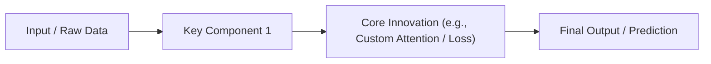

# Paper Explanation Output Template

Use this template structure whenever delivering a paper explanation to the user. It ensures that every analysis is approachable, rigorous, and directly answers what the user wants to know.

---

# 📄 [Paper Title]

**Authors / Venue:** [e.g. NeurIPS 2024 / arXiv:2310.xxxxx / Author Names]  
**Source / Link:** [URL or local file reference]

---

## 1. 💡 What It Does (In Plain English / ELI5)
*Goal: Explain what the paper achieves in simple, accessible, everyday language without academic jargon.*

- **The One-Liner:** [1 sentence summarizing the core achievement]
- **The Elevator Pitch:** [2-3 sentences explaining the premise as if talking to a smart friend from another field]
- **Intuitive Analogy:** [A real-world analogy that makes the mechanism or problem immediately understandable]

---

## 2. 🧠 How It Works: The Intuitive Deep-Dive
*Goal: Explain the core mechanics and methodology so the reader genuinely understands the 'how' and 'why'.*

### The Problem with Existing Methods
- What did researchers do before this paper?
- Why was that painful, slow, or flawed? (The specific bottleneck or limitation)

### The Core Idea & Mechanism
- Step-by-step walkthrough of how the proposed solution works:
  1. **Step 1 - Input / Preparation:** [What goes in]
  2. **Step 2 - The Key Innovation / Engine:** [How the magic happens]
  3. **Step 3 - Output / Result:** [What comes out]

### Visual Architecture / Workflow

### Demystifying Key Concepts / Math
- If the paper introduces key equations or math, explain them conceptually:
  - *What does each variable actually represent in real life?*
  - *Why is that specific operation needed?*

---

## 3. 🏆 Main Contributions
*Goal: A clear, bulleted breakdown of what is actually new and significant in this paper.*

- **Core Novelty / Algorithmic Innovation:**  
  - [e.g. Introduced the XYZ mechanism which eliminates quadratic memory complexity]
- **Architectural / Theoretical Advances:**  
  - [e.g. Proved convergence theorem for non-convex objectives under assumption X]
- **Empirical Results & Benchmarks:**  
  - [e.g. Achieved +2.4 BLEU over previous SOTA on WMT14; 3.5x faster training throughput]
- **Released Artifacts / Resources:**  
  - [e.g. Released open-source PyTorch code, new benchmark dataset containing 50k samples]

---

## 4. 🔭 Future Work & Limitations
*Goal: Extract exactly what the authors identified as remaining challenges and future research directions.*

### Explicit Future Directions (from the Authors)
- 📌 **Direction 1:** [Specific research path or next step the authors plan to investigate or suggest]
- 📌 **Direction 2:** [Extension to other modalities, larger scale, different domains]

### Acknowledged Limitations & Open Bottlenecks
- ⚠️ **Computational / Memory Cost:** [e.g. Requires 8x H100 GPUs or long training times]
- ⚠️ **Assumptions & Failure Modes:** [e.g. Fails on out-of-distribution reasoning or low-data regimes]
- ⚠️ **Open Questions for the Community:** [Unresolved theoretical gaps or unexplored variations]
